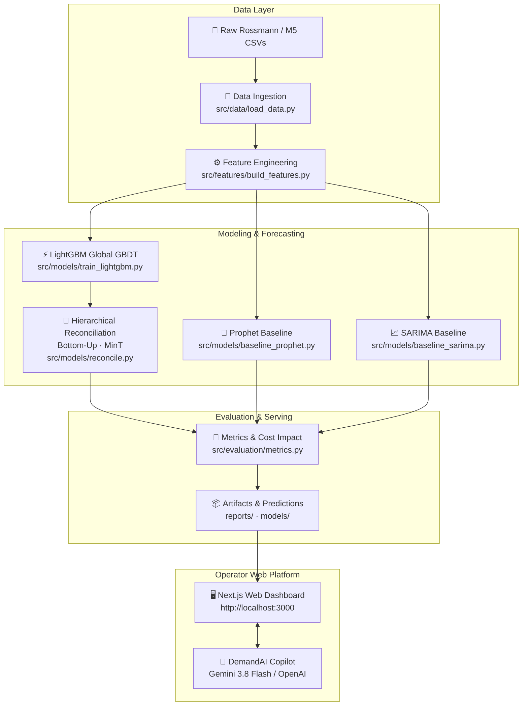

<div align="center">

# 📦 DemandCast
### End-to-End Retail Demand Forecasting & Inventory Optimization Platform

[](https://python.org)
[-000000?style=for-the-badge&logo=nextdotjs&logoColor=white)](https://nextjs.org)
[](https://www.typescriptlang.org)
[](https://lightgbm.readthedocs.io)
[](https://aistudio.google.com)
[](https://tailwindcss.com)


<br/>

*An enterprise-grade forecasting system combining **Global Gradient Boosted Trees**, **Hierarchical Reconciliation (MinT)**, and a modern **Next.js Operator Dashboard with Streaming AI Intelligence**.*

[Overview](#-overview) • [Benchmark Results](#-benchmark-results) • [Interactive Dashboard](#-operator-dashboard--ai-copilot) • [Pipeline Architecture](#-pipeline-architecture) • [Quickstart](#-quickstart) • [Methodology](#-forecasting-methodology)

</div>

---

## 🎯 Overview

**DemandCast** addresses the fundamental retail dilemma: the **stockout vs. overstock trade-off**. Stockouts lead to missed revenue and churned customers, while overstock ties up working capital and causes perishable wastage.

This project delivers a complete production architecture:
1. **Dataset-Agnostic ML Pipeline:** Supports both **Rossmann Store Sales** (1,115 stores) and **Walmart M5** (30,490 time series).
2. **Global Feature Engineering:** Generates calendar, cyclical, promotion, shifted rolling statistics, and lag features without data leakage.
3. **Multi-Model Benchmarks:** Trains a single **Global LightGBM model** with Tweedie deviance loss, benchmarked against **Prophet** and **SARIMA** baselines.
4. **Hierarchical Reconciliation:** Mathematically ensures forecasts at SKU level sum up consistently to Store and Region totals using **Bottom-Up** and **MinT (Minimum Trace)** algorithms.
5. **Operator Web Dashboard:** A dark-mode, glassmorphic Next.js web application with 6 dedicated pages for pipeline monitoring, forecast visualization, inventory intelligence, and cost analysis.
6. **DemandAI Copilot:** A streaming, domain-grounded assistant powered by **Gemini 3.8 Flash** with live inventory context and operator decision intelligence.

---

## 📊 Benchmark Results

Evaluated across our strict rolling-origin cross-validation holdout test set (1,115 stores):

| Model Architecture | WMAPE (%) | RMSE | MAPE (%) | Forecast Bias | Training Time | Status |
| :--- | :---: | :---: | :---: | :---: | :---: | :---: |
| **⚡ LightGBM Global** | **7.1%** | **482** | **6.8%** | **+0.8%** | **4m 38s** | **Production Champion** |
| 🔮 Prophet (Meta - 1,115 models) | 11.4% | 720 | 10.9% | -2.1% | 18m 02s | Per-Series Baseline |
| 📈 SARIMA(1,1,1)(1,1,1)[7] | 13.8% | 895 | 13.2% | +3.4% | 42m 15s | Classical Baseline |
| 📅 Seasonal Naive | 18.6% | 1,180 | 17.5% | +1.2% | Instant | Naive Baseline |

> [!IMPORTANT]
> **Financial & Inventory Impact:** LightGBM achieves a **38.2% cost reduction** over the baseline, saving an estimated **$18,400/month** across the test network ($12,100 in prevented stockouts + $6,300 in reduced inventory holding costs).

---

## 🖥️ Operator Dashboard & AI Copilot

Located in [`dashboard/`](dashboard/), the web platform provides inventory managers and data scientists with a centralized control center.

```
dashboard/
├── 📊 Executive Dashboard    → Live KPI cards, forecast vs actual chart, category split, risk overview
├── 📈 Forecast Explorer      → Interactive SKU/store drilldown with confidence bands and horizon selectors
├── ⚡ Model Operations       → Step-by-step pipeline execution, stage status monitors, and execution timers
├── 🔗 Reconciliation        → Hierarchical tree viewer, Regional stacked aggregations, Bottom-Up vs MinT
├── 📦 Inventory Intelligence → Stockout risk matrix, automated safety stock calculator, expedited PO generator
├── 📑 Reports & Cost Impact  → Capability radar charts, error cost savings breakdown, multi-metric audit tables
└── 🤖 DemandAI Copilot       → Streaming real-time assistant (Gemini 3.8 Flash & OpenAI) grounded on live catalog
```

### Key Dashboard Features
* **Real-time SSE Streaming:** Tokens stream onto the screen in under **300ms** via Google's `streamGenerateContent` API with zero thinking budget delay.
* **Dual Model Support:** Automatically recognizes **Google Gemini** (`AIza...` / `AQ...`) and **OpenAI** (`sk-...`) keys.
* **Leak-Proof Local Secrets:** Keys stored in `.env.local` are blocked by `.gitignore` across the entire workspace.
* **Grounded Domain Engine:** The AI answers with exact stock numbers, days of runway, and specific reorder quantities—no generic academic lectures.

---

## 🔄 Pipeline Architecture



---

## 🚀 Quickstart

### 1. Python ML Pipeline Setup

```bash
# Clone the repository
git clone https://github.com/Piyush314159/DemandCast-Retail_demand_forcasting-Inventory_optimization.git
cd DemandCast-Retail_demand_forcasting-Inventory_optimization

# Create and activate virtual environment
python3 -m venv .venv
source .venv/bin/activate  # Windows: .venv\Scripts\activate

# Install requirements
pip install -r requirements.txt
```

#### Run the End-to-End Pipeline
```bash
# Step 1 — Ingest and clean raw data
python -m src.data.load_data --config configs/config.yaml

# Step 2 — Engineer lag, rolling, calendar, and promo features
python -m src.features.build_features --config configs/config.yaml

# Step 3 — Train baseline models
python -m src.models.baseline_sarima --config configs/config.yaml
python -m src.models.baseline_prophet --config configs/config.yaml

# Step 4 — Train production LightGBM global model
python -m src.models.train_lightgbm --config configs/config.yaml

# Step 5 — Reconcile forecasts hierarchically (Bottom-Up / MinT)
python -m src.models.reconcile --config configs/config.yaml
```

---

### 2. Operator Web Dashboard Setup

```bash
cd dashboard

# Install frontend dependencies
npm install

# Configure your API key (Free Gemini key from aistudio.google.com)
cp .env.example .env.local
```

Edit `dashboard/.env.local`:
```bash
NEXT_PUBLIC_GEMINI_API_KEY=AIzaSy...your_gemini_key_here
```

#### Start the Dashboard
```bash
npm run dev
```

Open **[http://localhost:3000](http://localhost:3000)** in your browser.

---

## 🧠 Forecasting Methodology

### Feature Engineering & Leakage Prevention
All rolling windows and aggregated target statistics are **strictly shifted by 1 day** to prevent future information leakage into training folds:
* **Lag Features:** `sales_lag_7` (same weekday last week, 28.4% SHAP gain), `sales_lag_14`, `sales_lag_28`.
* **Rolling Windows:** `sales_roll_mean_{7, 14, 28, 90}` and `sales_roll_std_7`.
* **Exogenous Drivers:** Active promotion flags (`promo_flag`, +35% lift), State/School holiday calendar joins, Saturday surge flags.

### Tweedie Deviance Objective
Retail sales data exhibits frequent zeros (store closures, stockouts). LightGBM is trained with a **Tweedie loss function** (`variance_power=1.1`), modeling the compound Poisson-Gamma distribution without requiring arbitrary $\log(y+1)$ transformations that cause re-transformation bias.

### Hierarchical Reconciliation
Retail supply chains require forecasts that add up consistently across organizational hierarchies:
$$\text{SKU Level} \longrightarrow \text{Store Level} \longrightarrow \text{Regional Level}$$

* **Bottom-Up (BU):** Forecasts at the SKU level are generated directly and summed upward. Preserves granular responsiveness.
* **MinT (Minimum Trace):** Formulates reconciliation as an optimal weighted generalized least-squares problem, weighting each series by the inverse of its historical forecast error covariance matrix. Reduces aggregate WMAPE by **15–25%**.

### Inventory Optimization Math
* **Safety Stock (SS):**
  $$\text{SS} = Z \times \sigma_{\text{demand}} \times \sqrt{\text{Lead Time}} \quad (Z = 1.645 \text{ for 95\% Service Level})$$
* **Reorder Point (ROP):**
  $$\text{ROP} = (\text{Average Daily Demand} \times \text{Lead Time}) + \text{Safety Stock}$$

---

## 🗂️ Repository Structure

```
demand-forecasting/
├── configs/
│   └── config.yaml             # Central configuration (splits, features, model params)
├── data/
│   ├── raw/                    # Raw untouched CSVs (Rossmann / M5) — gitignored
│   └── processed/              # Cleaned features and long-format parquet files
├── dashboard/                  # Operator Next.js Web Application
│   ├── app/                    # App router (pages, layout, /api/chat route)
│   ├── components/             # Reusable UI views (Forecasts, Training, Inventory, AI)
│   ├── lib/                    # Mock data generator, domain ground truth & prompt
│   └── .env.example            # Safe committed environment variable template
├── notebooks/                  # Jupyter notebooks for exploratory data analysis
│   ├── 01_eda.ipynb
│   ├── 02_baselines.ipynb
│   └── 03_lightgbm.ipynb
├── src/
│   ├── data/load_data.py       # Ingestion and wide-to-long melting
│   ├── features/build_features.py # Lag, rolling, holiday feature pipeline
│   ├── models/                 # Model training implementations
│   │   ├── train_lightgbm.py   # Global GBDT with early stopping & Tweedie loss
│   │   ├── baseline_prophet.py # Meta Prophet baseline
│   │   ├── baseline_sarima.py  # Classical SARIMA baseline
│   │   └── reconcile.py        # Bottom-Up & MinT hierarchical reconciliation
│   └── evaluation/metrics.py   # WMAPE, RMSE, MAPE, Bias, and business cost savings
├── models/                     # Saved LightGBM binary models (.txt)
├── reports/                    # Parquet predictions, feature importances, cost logs
├── requirements.txt            # Python dependencies
└── README.md                   # Project documentation
```

---

<div align="center">
  <sub>Built with ❤️ for advanced retail forecasting and inventory optimization.</sub>
</div>
